<p align="center">
  
</p>

<p align="center">
  
  
  
  
  
  
</p>

<p align="center">
  <a href="#features">Features</a> ·
  <a href="#getting-started">Getting started</a> ·
  <a href="#api">API</a> ·
  <a href="#mobile-apps">Mobile apps</a>
</p>

---

A multi-layered **pre-visit inspection engine for malicious QR codes (quishing)**.
A QR code is decoded, classified, and its target analysed on the server *before*
the user ever opens it — the scanning device never connects to the target.

## Features

- **QR decoding & payload classification** — URL, Wi-Fi, vCard, email, SMS, tel,
  UPI / crypto payments, plain text.
- **Static URL analysis** — suspicious structure, IP hosts, look-alike domains,
  URL-shortener detection, unsafe-target validation (SSRF protection).
- **Redirect-chain analysis** — follows and inspects every hop.
- **Domain intelligence** — WHOIS / domain age.
- **Dynamic content analysis** — headless-browser rendering (Playwright) with
  credential-form and brand-impersonation detection, plus a screenshot.
- **Reputation lookup** — VirusTotal API v3.
- **Risk scoring** — a single 0–100 score with a SAFE / CAUTION / DANGEROUS verdict.
- **Optional Tor egress** — route outbound scans through a SOCKS proxy so the
  analyst's IP is never exposed to attacker infrastructure.

## Project structure

```
backend/          FastAPI app (api.py) and the analysis modules (modules/)
frontend/         Web UI served by the backend at /
mobile/           Expo / React Native app (camera scan → backend verdict)
mobile-native/    Native Android (Kotlin) client — source files + setup guide
tests/            Test scripts for the decoder, classifier, pipeline and API
run_server.py     Starts the backend on http://127.0.0.1:8000
```

## Getting started

```powershell
python -m venv venv
venv\Scripts\activate            # macOS/Linux: source venv/bin/activate
pip install -r requirements.txt
playwright install chromium

copy .env.example .env           # then add your VirusTotal key
python run_server.py
```

- Web UI: http://127.0.0.1:8000
- API docs (Swagger): http://127.0.0.1:8000/docs

### Configuration (`.env`)

| Variable        | Purpose                                                        |
|-----------------|----------------------------------------------------------------|
| `QI_VT_API_KEY` | VirusTotal API v3 key (free tier is enough)                     |
| `QI_PROXY`      | Optional, e.g. `socks5://127.0.0.1:9150` to scan through Tor     |

## API

| Method | Endpoint            | Description                                  |
|--------|---------------------|----------------------------------------------|
| GET    | `/api/health`       | Health check                                 |
| POST   | `/api/scan-file`    | Upload a QR image (PNG/JPG/WEBP)             |
| POST   | `/api/scan-url`     | Inspect a URL directly                       |
| POST   | `/api/scan-payload` | Inspect decoded QR text (used by the apps)   |

## Mobile apps

Both apps decode the QR on the device and send only the decoded text to
`/api/scan-payload`. To reach your local backend from a phone, expose it with a
tunnel (e.g. `cloudflared tunnel --url http://127.0.0.1:8000`) and paste the URL
into the app.

- Expo app: see [mobile/README.md](mobile/README.md)
- Native Android app: see [mobile-native/README.md](mobile-native/README.md)
  — a prebuilt APK is available on the Releases page.

## Running the tests

From the repository root:

```powershell
python -m tests.test_classifier
python -m tests.test_decoder
python -m tests.test_api_endpoints
```

## Safety note

Scanning live phishing pages connects to attacker infrastructure. Enable
`QI_PROXY` (Tor) before analysing untrusted links.
